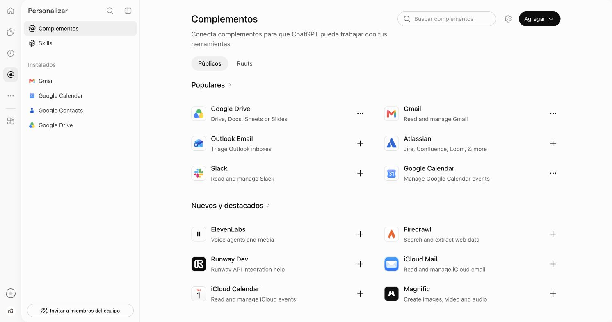
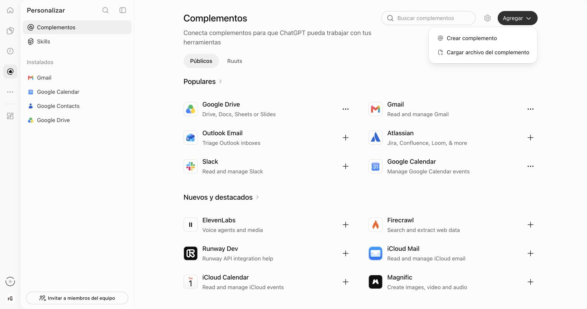
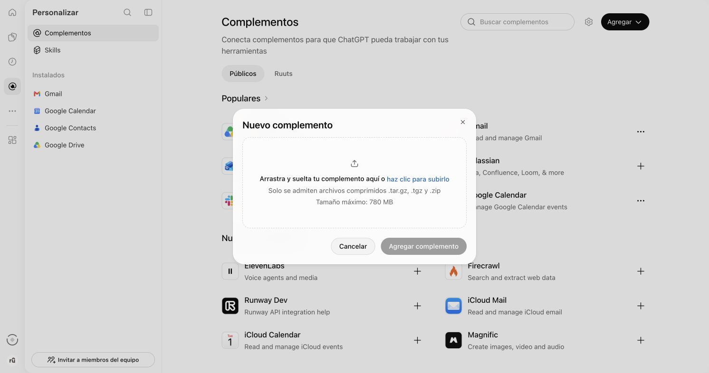
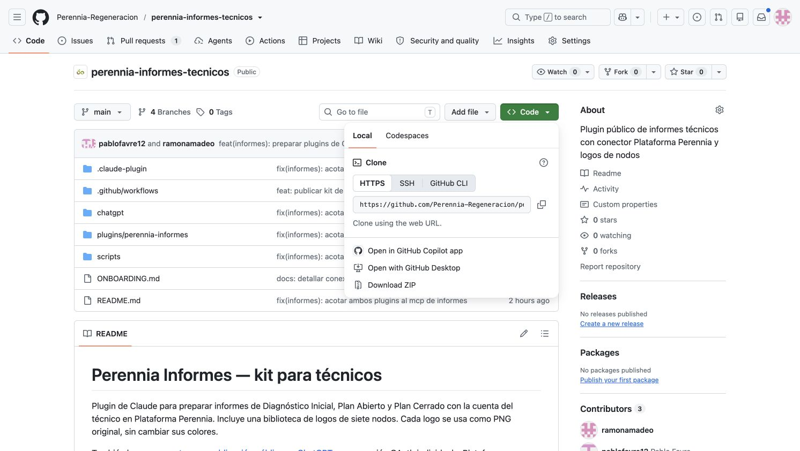
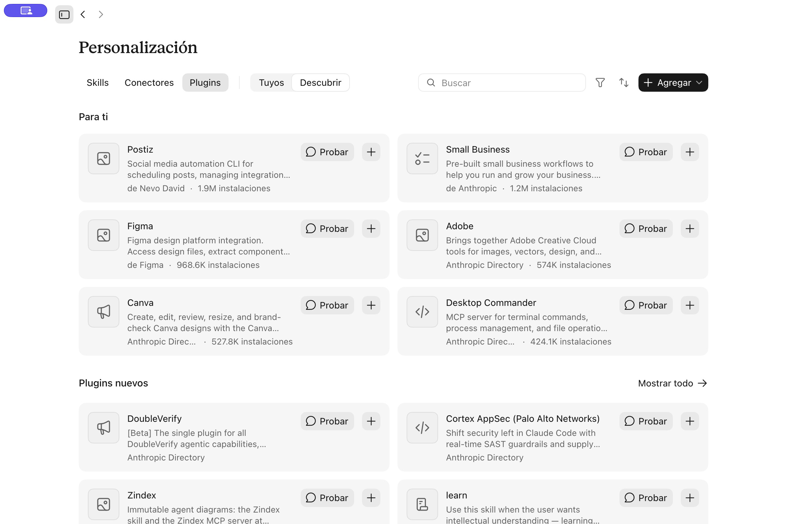
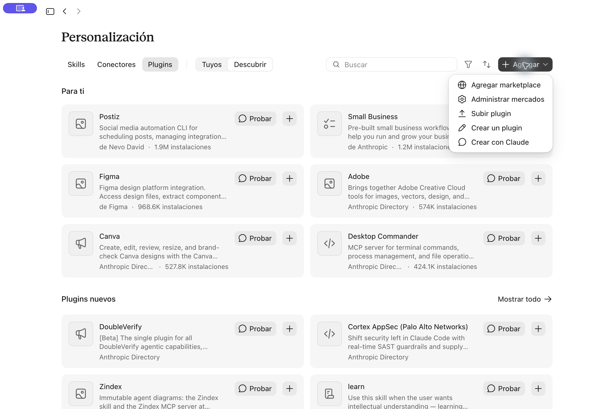
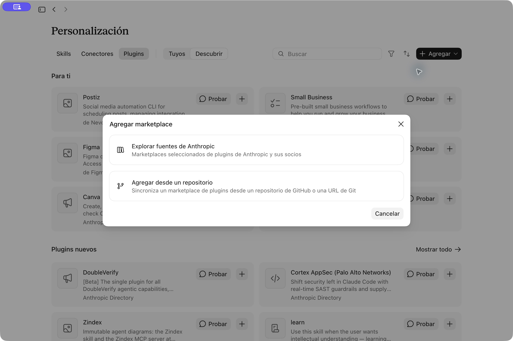
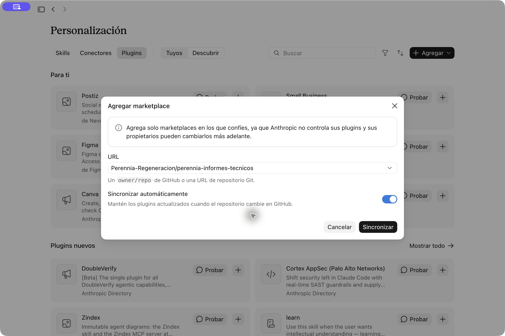

# Instalar Informes Perennia

Este es el manual para técnicos. Elegí la aplicación que usás: [ChatGPT](#si-tenés-chatgpt) o [Claude](#si-tenés-claude). En ambos casos, conectá **tu propia cuenta de Plataforma Perennia**. El repositorio es público y no requiere cuenta de GitHub.

El plugin prepara borradores de **Diagnóstico Inicial, Plan Abierto y Plan Cerrado**. Vos revisás las cifras, el análisis y el logo antes de firmar o compartir el informe. Usa los permisos que ya tiene tu usuario en Plataforma; [acá está el catálogo del rol técnico](ACCESOS-ROL-TECNICO.md).

> **Antes de empezar:** necesitás una cuenta activa de Plataforma y una cuenta de ChatGPT o Claude. Las capturas muestran la interfaz de noviembre de 2026; algunos nombres pueden variar según la versión.

## Si tenés ChatGPT

### 1. Descargá el archivo del plugin

Abrí [**Descargar Informes Perennia para ChatGPT**](chatgpt/perennia-informes-chatgpt-0.1.3.zip). En GitHub, pulsá **Descargar** para guardar `perennia-informes-chatgpt-0.1.3.zip` en tu computadora. Descargá **ese ZIP del plugin**, no el ZIP completo del repositorio. El repositorio es público; no necesitás una cuenta de GitHub.

### 2. Abrí Complementos en ChatGPT web

Entrá en [ChatGPT](https://chatgpt.com/) con tu cuenta y abrí **Complementos** en la barra lateral:



### 3. Elegí cargar el archivo

Pulsá **Agregar → Cargar archivo del complemento**:



En la ventana **Nuevo complemento**, pulsá **haz clic para subirlo** y seleccioná el ZIP que descargaste. Después pulsá **Agregar complemento**:



La opción de carga depende de los permisos de tu cuenta o espacio de trabajo. Si no aparece, usá la [alternativa de escritorio](#alternativa-chatgpt-de-escritorio) o pedí al administrador de tu espacio que habilite la carga de plugins. [Ayuda oficial de OpenAI sobre carga de ZIP](https://help.openai.com/en/articles/20001256-plugins-in-chatgpt).

### 4. Conectá Plataforma y pedí el informe

Abrí **Informes Perennia**, conectá **conector-plataforma** e iniciá sesión con **tu usuario de Plataforma Perennia**. Revisá y autorizá el acceso que muestra Plataforma. En un chat nuevo, escribí:

> Comprobá mi conexión con Plataforma Perennia usando `mis_capacidades`. No hagas cambios.

Si responde con tu identidad, pedí: **“Ayudame a preparar un borrador de Diagnóstico Inicial / Plan Abierto / Plan Cerrado del establecimiento [nombre]”**. Indicá el servicio o campaña y adjuntá tus notas de campo. Si querés conservar tu formato, adjuntá un informe anterior tuyo como modelo de **estilo**, sin copiar sus datos.

### Alternativa: ChatGPT de escritorio

Si tu cuenta no permite cargar ZIP en la web, podés instalar el plugin desde el repositorio público en ChatGPT de escritorio. Necesitás Git y [Codex CLI](https://developers.openai.com/codex/cli). La captura muestra el botón **Code** y la dirección HTTPS del repositorio:



En una terminal, ejecutá estos comandos y reemplazá `<carpeta-del-repo>` por la ruta completa de la carpeta descargada:

```bash
git clone https://github.com/Perennia-Regeneracion/perennia-informes-tecnicos.git
codex plugin marketplace add <carpeta-del-repo>
```

Reiniciá ChatGPT de escritorio. En **Plugins**, elegí el origen **Informes Perennia (local)** y agregá **perennia-informes**. Esta captura oficial muestra dónde aparece el selector de origen y el botón **+**; buscá los nombres de Perennia en tu pantalla:


*Ejemplo de [OpenAI Developers](https://developers.openai.com/plugins/build/plugins).* Conectá Plataforma y seguí el paso 4.

## Si tenés Claude

En Claude chat o la app de Claude no hace falta clonar el repositorio. Claude puede agregarlo directamente desde GitHub. [Guía oficial de Anthropic](https://support.claude.com/en/articles/13837440-use-plugins-in-claude).

### 1. Abrí Plugins

Entrá en **Personalización → Plugins**:



### 2. Agregá el marketplace

Pulsá **Agregar → Agregar marketplace**:



Elegí **Agregar desde un repositorio**:



### 3. Indicá el repositorio de Perennia

Ingresá `Perennia-Regeneracion/perennia-informes-tecnicos` y pulsá **Sincronizar**:



Dentro del marketplace, agregá el plugin **perennia-informes**. Abrí sus **Conectores** y conectá **conector-plataforma**. Iniciá sesión con tu propio usuario de Plataforma y autorizá la conexión cuando se solicite.

### 4. Prepará tu primer borrador

Abrí un chat nuevo con el plugin activo y escribí:

> Comprobá mi conexión con Plataforma Perennia usando `mis_capacidades`. No hagas cambios.

Después indicá el establecimiento, el tipo de informe, el servicio o campaña y tu nombre. Podés adjuntar notas, fotos e informes anteriores como referencia de formato. Revisá el borrador antes de firmarlo o enviarlo.

## Si necesitás ayuda

- **No aparece el plugin:** en la web, revisá si el ZIP se agregó; en escritorio, confirmá que registraste la carpeta correcta y reiniciá la app. En Claude, revisá que el marketplace se haya sincronizado.
- **Plataforma pide entrar de nuevo:** conectá el MCP con tu propio usuario de Plataforma. No compartas contraseñas ni tokens.
- **Falta un dato:** indicá el establecimiento y servicio con más precisión. Si Plataforma no lo devuelve, aportá tus notas y dejá el dato pendiente de verificar.
- **Querés actualizar el plugin:** en ChatGPT web, descargá y cargá la nueva versión del ZIP; en ChatGPT de escritorio, ejecutá `git pull` dentro de la carpeta descargada y refrescá el marketplace; en Claude, actualizá el marketplace desde Plugins.

Para verificar la instalación antes de entregarla a todo el equipo, seguí la [prueba guiada](ONBOARDING.md). No subas informes de productores al repositorio público ni a tickets públicos.
